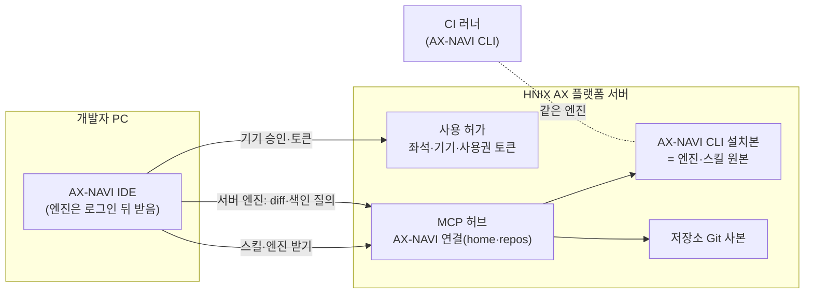

# AX-NAVI 관리 개요 — 서버 엔진

> AX-NAVI 를 회사에 들이고 운영하는 관리자가 알아야 할 구성, 사용 허가의 개념, 플랫폼 서버에서 도는 서버 엔진(Git 사본 색인·diff 리뷰·보안 점검·`/mcp`)을 설명합니다. **대상**: 플랫폼 관리자(SYS_ADMIN). **메뉴**: 플랫폼 왼쪽 메뉴 › AX-NAVI · MCP 허브 · 서버 설정 파일 `hnix-ax.yaml`.

플랫폼 화면의 **AX-NAVI 사용 허가**(사람·기기·유출본 확인)와 **AX-NAVI 조직 설정** 사용법은 [AX-NAVI 사용 허가 · 조직 설정](/admin/platform/axnavi.md)에 있습니다. 이 쪽은 그 뒤에 있는 구조와 서버 쪽 준비를 다룹니다.

## 구성



| 구성 | 어디에 | 하는 일 |
|---|---|---|
| **AX-NAVI IDE** | 개발자 PC | 설치형 IDE. 로그인 전에는 잠겨 있습니다 |
| **AX-NAVI CLI** | **플랫폼 서버와 CI 러너에만** | 판정 엔진과 스킬·에이전트의 원본. 개발 PC 에는 깔지 않습니다 |
| **사용 허가** | 플랫폼 | 로그인·기기 승인, 허가(좌석), 사용권 토큰, 스킬·엔진 배포, 유출 문서 추적 |
| **서버 엔진** | 플랫폼 | '서버만' 좌석을 위해 서버가 대신 색인·리뷰·점검 |
| **조직 설정** | 플랫폼 | 규칙·양식·스킬·MCP·정책 묶음을 전사·팀에 배포 — [조직 설정 배포와 CI 게이트](/admin/axnavi/profiles.md) |

> **참고** IDE 와 CI 가 같은 엔진 코드를 쓰므로, 개발자가 IDE 에서 본 판정과 머지 요청에서 받는 판정이 같습니다. 리뷰·점검·게이트·색인은 AI 를 부르지 않습니다.

## 사용 허가의 개념

AX-NAVI IDE 설치본은 플랫폼에 로그인해 승인받은 기기에서만 동작합니다. 목표는 두 가지입니다.

- **밖에서 훔친 사본은 쓸모없게** — 로그인 전에는 모델 호출과 AX-NAVI 명령이 모두 막힙니다. 이 검사는 릴리스 빌드에 박혀 있어 설정·환경 변수로 끌 수 없습니다.
- **안에서 새면 누가 흘렸는지 알게** — 기기마다 내려 주는 스킬·에이전트 문서와 엔진에 보이지 않는 표식이 들어갑니다. 밖에서 발견된 문서를 **AX-NAVI 사용 허가** 화면에 넣으면 받은 사람·기기가 나옵니다.

| 용어 | 뜻 |
|---|---|
| 허가(좌석) | 이 사람이 AX-NAVI 를 써도 된다는 표시. 회수하면 그 사람의 모든 기기가 잠깁니다 |
| 기기 | 승인받은 PC. 한 사람당 기기 수에 상한이 있습니다. 사용자가 직접 끊거나 관리자가 폐기합니다 |
| 사용권 토큰 | IDE 가 기기 비밀로 주기적으로 받는 짧은 토큰(기본 1시간). 회수·폐기가 반영되는 최대 시간입니다 |
| 오프라인 기간 | 플랫폼에 닿지 않아도 받아 둔 스킬·엔진으로 버티는 날수(기본 3일) |
| 엔진 위치 | **PC**(IDE 에 자동 설치, 기본) 또는 **서버만**(PC 에 엔진을 두지 않음) — 좌석마다 정합니다 |

### 설정 — `hnix-ax.yaml`

```yaml
axnavi:
  seats: listed          # listed = 화면에서 허가한 사람만 · all = 활성 사용자 모두
  maxDevices: 2          # 1인 기기 수
  licenseMinutes: 60     # 사용권 토큰 수명(분)
  offlineDays: 3         # 플랫폼에 닿지 않을 때 버티는 날수
  connection: null       # 엔진·스킬 원본으로 쓸 MCP 허브 AX-NAVI 연결 이름(비우면 첫 번째)
  defaultEngine: local   # 새 허가의 엔진 위치 — local(PC) · server
  ideDir: null           # 개인 PC 설치 파일 폴더(비우면 <data>/downloads)
  gatewayModel: null     # 연결 꾸러미의 사내 게이트웨이 모델(비우면 켜 둔 첫 대화 모델)
```

설정을 바꾼 뒤에는 플랫폼 서비스를 다시 시작합니다([운영](/admin/operations.md)).

## 엔진·스킬의 원본 — MCP 허브의 AX-NAVI 연결

플랫폼이 IDE 에 내려 주는 엔진과 스킬, 서버 엔진의 계산은 모두 **서버에 깐 AX-NAVI CLI 한 벌**에서 나옵니다. 그 위치를 MCP 허브의 **AX-NAVI 연결**(종류 `axnavi`)에 적습니다.

1. 플랫폼 서버에 AX-NAVI CLI 를 설치합니다(예 `C:\tools\AX-NAVI-CLI`).
2. 플랫폼 **MCP 허브**에서 종류 `axnavi` 연결을 만듭니다([MCP 허브 · 정책 · 승인](/admin/platform/hub.md)).
3. 설정에 설치 폴더와 저장소를 적습니다.

```json
{
  "home": "C:\\tools\\AX-NAVI-CLI",
  "repos": [
    { "name": "hr-legacy", "root": "D:\\axnavi\\repos\\hr-legacy",
      "gitUrl": "http://gitlab.corp.local/hr/hr-legacy.git", "branch": "main" }
  ]
}
```

| 항목 | 뜻 |
|---|---|
| `home` | AX-NAVI CLI 설치 폴더(`agents/lib/query-index.mjs` 가 있어야 함) |
| `repos[].name` | 저장소 이름 — IDE 와 도구가 이 이름으로 고릅니다 |
| `repos[].root` | 서버에 둔 저장소 사본 폴더 |
| `repos[].gitUrl` · `branch` | 있으면 색인 전에 `git pull --ff-only`(폴더가 없으면 `git clone`). `http(s)://`·`ssh://`·`git@` 주소만 |
| `repos[].indexDir` | 색인 위치(기본 `<root>/_workspace/index`) |

> **주의** 저장소를 하나 이상 등록해야 저장됩니다. `gitUrl` 이 없으면 `root` 폴더가 서버에 실제로 있어야 합니다.

## 서버 엔진

엔진 위치가 **서버만**인 좌석(외주 인력처럼 엔진과 스킬 원본을 PC 에 두면 안 되는 사람)은 PC 에 엔진을 받지 않습니다. 대신 플랫폼이 저장소의 Git 사본으로 계산해 결과만 줍니다.

| 기능 | 서버 엔진에서 | 감사 기록 |
|---|---|---|
| 색인 만들기 | 서버가 Git 최신본을 받아(pull) 색인을 다시 만듭니다. 오래 걸리면 시작만 하고 돌아옵니다 | `axnavi.index.build` |
| 색인 질의 | IDE 가 사용권 토큰으로 플랫폼 `/mcp` 에 붙어 색인 도구를 씁니다 | — |
| 변경 리뷰 | IDE 가 `git diff` 원문(최대 5MB)을 보내면 서버 색인으로 영향 범위·규칙 위반·점수를 냅니다 | `axnavi.review`(판정·파일 수) |
| 보안 점검 | 보낸 파일만, 또는 서버 사본 전체 | `axnavi.scan` |
| 스킬 | 서버 도구만으로 도는 12개만(`/find`, `/flow`, `/impact`, `/review-sql`, `/security-scan` 등) | — |
| 쓸 수 없음 | 단계 게이트, 환경 점검, PC 에서 빌드·검증하는 스킬 14개(`/safe-modify`, `/harness-init` 등) | — |

IDE 는 작업 폴더의 `origin` 주소를 `gitUrl` 과 맞춰 저장소를 고르고, 맞는 것이 없으면 개발자에게 목록에서 고르게 합니다. 등록된 저장소가 없으면 `플랫폼에 등록된 저장소가 없습니다 — 관리자에게 허브의 AX-NAVI 연결에 이 저장소를 등록해 달라고 하세요.` 가 뜹니다.

> **주의** 서버 색인은 Git 원격의 최신본 기준입니다. 개발자 PC 의 푸시하지 않은 변경은 서버 색인에 없으므로, 영향 범위가 실제와 조금 다를 수 있습니다.

### `/mcp` 를 사용권 토큰으로 쓸 때

IDE 가 사용권 토큰으로 `/mcp` 에 붙으면 **AX-NAVI 연결의 도구만** 보이고 부를 수 있습니다(PMS-X·문서 등 다른 허브 도구는 숨김).

| 도구 | 하는 일 |
|---|---|
| `repos` · `summary` | 색인된 저장소 목록·규모 |
| `search` · `symbol` · `callers` · `callees` · `trace` | 용어 검색, 클래스·메서드 위치, 호출 관계 |
| `sql` · `table` · `column` · `schema` · `endpoint` | SQL 사용처, 테이블·컬럼 영향도, 테이블 정의, HTTP 주소 |
| `index_status` · `index_build` | 서버 색인 상태, 다시 만들기 |
| `review` · `scan_security` | 변경 리뷰(GO·HOLD·STOP), 보안 점검 |

## 연결 꾸러미 — 로그인하면 IDE 가 받는 키

기기 승인 직후 IDE 는 그 기기 전용 키 3개를 받아 스스로 설정합니다. 개발자가 키를 손으로 넣지 않습니다.

| 키 | 용도 | IDE 에서 |
|---|---|---|
| `llm` | 사내 게이트웨이 | AI 연결 프로필 `AX-NAVI 사내 게이트웨이` |
| `ingest` | 사용량 기록 | 작업 요약을 AI 사용 현황으로 |
| `mcp` | MCP 허브 | 채팅의 MCP 서버 `hnix-ax` |

- 키는 기기 주인 이름으로, 그 사람의 기본 워크스페이스에 `AX-NAVI IDE · <기기>` 이름으로 발급됩니다. 기본 워크스페이스가 없으면 발급되지 않습니다.
- 기기를 끊거나 허가를 회수하면 그 기기의 키도 꺼집니다. 개발자가 **연결 다시 받기**를 하면 지난 키는 꺼지고 새 키가 나옵니다.

## 설치 파일 배포

| 할 일 | 방법 |
|---|---|
| 내려받기 목록에 올리기 | `HNIX-AX-PC-Setup-<판>.exe` 를 `axnavi.ideDir`(기본 `<data>/downloads`)에 둡니다. 사용자는 **내 연결 설정**에서 5분짜리 주소로 받습니다(감사 `axnavi.ide.download`) |
| 여러 PC 에 조용히 | `HNIX-AX-PC-Setup-<판>.exe /VERYSILENT /SERVER=http://<플랫폼>:8700` (PC 공용 설치는 `/ALLUSERS` 추가) |
| 플랫폼 주소 고정 | PC 공용 정책 `%ProgramData%\axnavi\policy.json` 의 `platform` — 개발자가 다른 주소로 연결할 수 없습니다 |
| 보안 프로그램 예외 | 빌드와 함께 나오는 `-보안검토.md`·`-hashes.csv` 를 보안 담당자에게 주고 게시자(코드 서명 인증서) 기준 예외를 요청 |

서명이 없는(`-unsigned`) 설치 파일은 내려받기 목록에 오르지 않습니다. 자세한 배포 절차는 [개인 PC 배포 — IDE·연결](/admin/install-pc.md)에 있습니다.

```json
{ "platform": "http://ax.corp.local:8700", "allowedRoutes": ["subscription", "gateway"], "preferred": "subscription",
  "gateway": { "baseUrl": "http://ax.corp.local:8700/v1", "model": "hnix-claude" },
  "message": "기밀 과제는 사내 게이트웨이만 씁니다" }
```

`allowedRoutes`(허용 연결: `subscription`·`key`·`gateway`)와 `preferred` 로 개발자가 쓸 AI 연결도 정합니다. 저장소의 `.axnavi/policy.json` 은 허용 범위를 **좁히기만** 합니다.

## 운영 점검표

| 주기 | 할 일 |
|---|---|
| 입사·투입 | 허가 주기, 엔진 위치 정하기(외주는 '서버만' 검토) |
| 퇴사·철수 | 허가 회수 — 1시간(토큰 수명) 안에 모든 기기가 잠김 |
| 저장소 추가 | 허브 AX-NAVI 연결의 `repos` 에 등록, 서버 색인 만들기 |
| AX-NAVI CLI 판 올림 | 서버의 `home` 폴더를 새 판으로 — 다음 확인 때 IDE 가 바뀐 엔진·스킬만 다시 받음. CI 러너의 판도 맞춤 |
| 유출 의심 | **AX-NAVI 사용 허가** 화면에서 발견된 문서로 추적 |

## 관련 쪽

- [AX-NAVI 사용 허가 · 조직 설정](/admin/platform/axnavi.md)
- [조직 설정 배포와 CI 게이트](/admin/axnavi/profiles.md)
- [MCP 허브 · 정책 · 승인](/admin/platform/hub.md)
- [개인 PC 배포 — IDE·연결](/admin/install-pc.md)
- [설치 · 로그인 · 기기 승인](/user/axnavi/install.md)
