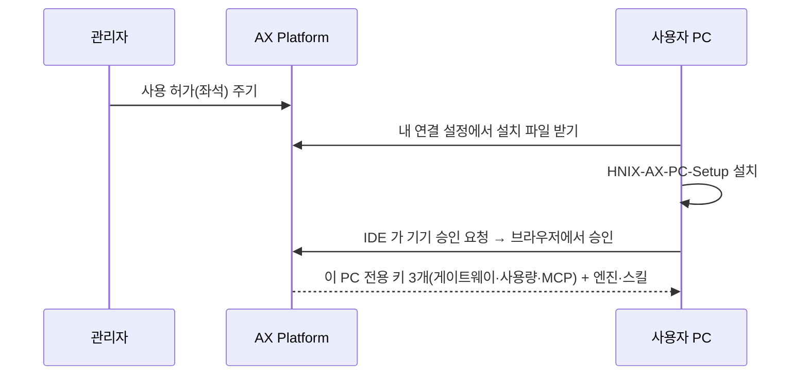

# 개인 PC 배포 — IDE·연결

> 개발자·운영자 PC 에 AX-NAVI IDE 를 깔고 회사 플랫폼에 잇는 일을 관리자가 준비·배포하는 법입니다. 사용자 쪽 절차는 [설치 · 로그인 · 기기 승인](/user/axnavi/install.md)에 있습니다. **대상**: 시스템 관리자, PC 배포 담당.

## 어떻게 이어지나



사용자는 키·환경 변수를 손으로 넣지 않습니다. 승인하면 IDE 가 스스로 설정하고, 기기를 끊거나 허가를 회수하면 그 PC 의 키가 함께 꺼집니다.

## 1. 준비

| 할 일 | 어디서 |
|---|---|
| 서버 설치가 끝났는지 | [서버 설치](/admin/install-server.md) — 서버 설치가 개인 PC 설치 파일을 플랫폼 내려받기 폴더에 넣어 둡니다 |
| IDE 를 쓸 사람에게 **사용 허가** | 플랫폼 **AX-NAVI 관리 › 사용 허가** → [AX-NAVI 사용 허가 · 조직 설정](/admin/platform/axnavi.md) |
| 1인 기기 수·허가 방식 확인 | 플랫폼 설정 `axnavi.seats`(`listed` = 허가한 사람만, `all` = 모든 활성 사용자), `axnavi.maxDevices`(기본 2) |
| (선택) 조직 규칙·스킬 묶음 | **AX-NAVI 관리 › 조직 설정** → [조직 설정 배포](/admin/axnavi/profiles.md) |
| (선택) 보안 프로그램 예외 | 아래 4번 |

## 2. 사용자가 직접 설치하게 하기(권장)

사용자에게 플랫폼 주소와 계정만 알려 주면 됩니다. 사용자는:

1. 플랫폼에 로그인 → **내 연결 설정** › **개인 PC 설치 파일 받기**
2. 설치(관리자 권한 필요 없음) → IDE 가 열리면 **로그인**
3. 브라우저 승인 화면에서 **승인**

자세한 그림은 [설치 · 로그인 · 기기 승인](/user/axnavi/install.md)·[내 연결 설정](/user/platform/setup.md).

## 3. 여러 PC 에 한꺼번에 깔기

배포 도구(SCCM·Intune 등)로 조용히 설치합니다.

```powershell
HNIX-AX-PC-Setup-<판>.exe /VERYSILENT /SERVER=http://ax.corp.local:8700             # 사용자별 설치
HNIX-AX-PC-Setup-<판>.exe /VERYSILENT /ALLUSERS /SERVER=http://ax.corp.local:8700   # PC 공용 설치
```

설치 뒤 각 사용자가 처음 IDE 를 열 때 한 번 로그인·승인하면 됩니다.

**주소와 허용 AI 경로 고정(정책 파일)** — 플랫폼 **내 연결 설정** 아래 **관리자 — 전 직원 일괄 배포** 칸에서 명령·`policy.json`·Claude Code 관리 설정을 만들 수 있습니다. `policy.json` 을 PC 의 `%ProgramData%\axnavi\policy.json` 에 배포하면 사용자가 다른 서버로 바꾸지 못하고, 정해 둔 AI 경로만 씁니다.

## 4. 보안 프로그램(백신·EDR)이 막을 때

설치 파일과 그 안의 실행 파일·스크립트는 코드 서명되어 있습니다. 막히면 보안 담당자에게 릴리스에 있는 두 파일을 주세요.

| 파일 | 내용 |
|---|---|
| `AX-NAVI-IDE-<판>-보안검토.md` | 설치 위치, 실행하는 프로세스, 통신 대상, 인증서 지문 |
| `AX-NAVI-IDE-<판>-hashes.csv` | 파일별 SHA-256·서명자 |

**게시자(코드 서명 인증서) 기준 예외**를 요청하면 판이 바뀌어도 다시 등록하지 않아도 됩니다.

## 5. Claude 구독을 쓰는 사람

- 구독(Pro·Max·Team·Enterprise)이 있으면 각자 PC 에 Claude Code 를 깔고 `claude` 로 **본인이** 로그인합니다. IDE 가 구독을 먼저 쓰고, 안 될 때 사내 모델로 넘어갑니다.
- 구독 자격 증명은 회사 서버로 가지 않습니다. 플랫폼에는 사용량(토큰·비용·도구 이름)만 기록됩니다.
- 조직 API 키로 Claude 를 쓰게 하려면 게이트웨이에 연결하고 별칭으로 내줍니다 → [LLM 게이트웨이 설정](/admin/platform/gateway.md)

## 6. 판 올리기와 정리

| 할 일 | 방법 |
|---|---|
| 새 판 배포 | 새 서버 꾸러미를 설치하면 플랫폼의 설치 파일도 바뀝니다. 사용자는 새 `HNIX-AX-PC-Setup` 을 덮어 설치(주소·로그인 유지). 배포 도구로는 같은 명령 |
| 기기 끊기 | 사용자 본인: **내 연결 설정 › 내 AX-NAVI 기기**. 관리자: **AX-NAVI 관리 › 사용 허가 › 기기** |
| 퇴사·이동 | **사용 허가** 회수 — 그 사람의 모든 기기·키가 바로 꺼집니다 |
| 유출된 스킬 파일 확인 | **AX-NAVI 관리 › 사용 허가 › 유출본 확인** — 파일에 숨은 기기 표식으로 받은 사람을 찾습니다 |

## 관련 쪽
- [설치 · 로그인 · 기기 승인(사용자)](/user/axnavi/install.md)
- [AX-NAVI 사용 허가 · 조직 설정](/admin/platform/axnavi.md)
- [AX-NAVI 관리 개요 — 서버 엔진](/admin/axnavi/README.md)
