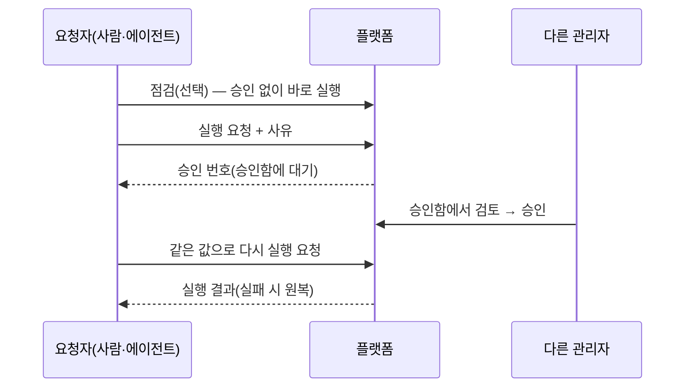

# 자동화 흐름 · 런북 등록

> 정해진 순서대로 도는 자동화 흐름을 설계·공개하고, 서버 조치(배치 재실행·재기동 등)를 런북으로 등록해 승인 뒤에만 실행되게 합니다. **대상**: 시스템 관리자. **메뉴**: 에이전트·자동화 › 자동화 흐름, 에이전트·자동화 › 런북.

## 화면 구성

| 화면 | 탭·영역 | 하는 일 |
|---|---|---|
| 자동화 흐름 | **목록** | 흐름 목록(단계·버전·공개·수정 시각), **열기** · **실행 기록** · **평가** |
| | **편집기** | 노드를 끌어 놓아 흐름 그리기, 저장, 버전 기록, 시험 실행. 관리자에게는 아래 **자동 실행** 카드 |
| | **실행 기록** | 내가 실행한 흐름(관리자는 전체)과 단계별 결과 |
| 런북 | **런북** 카드 | 등록된 런북 목록, **실행…** · **수정** · **삭제**, 오른쪽 위 **런북 등록** |
| | **실행 기록** 카드 | 실행·점검·원복 기록. 행을 펼치면 출력 |

흐름을 실행하고 결과를 보는 방법은 [자동화 흐름](/user/platform/flows.md), 런북 실행 요청은 [런북 실행 요청](/user/platform/runbooks.md)을 보세요.

## 자동화 흐름 — 편집기

<figure><figcaption>편집기 — 서비스 요청 분류·처리 흐름(버전 1)</figcaption></figure>

| 영역 | 내용 |
|---|---|
| 맨 위 줄 | 흐름 이름, `vN`(버전), 검증 꼬리표(`실행 가능` · `주의 N` · `고칠 곳 N`), `저장 안 됨`, **예시 불러오기** · **버전 기록** · **시험 실행** · **저장** |
| 노드 상자 | 노드를 캔버스로 끌어다 놓거나 누르면 추가됩니다 |
| 캔버스 | 선: 노드 오른쪽 점을 끌어 다른 노드 왼쪽 점에. 지우기: 누르고 Delete. 왼쪽 아래 **＋ · － · 맞춤 · 정렬** |
| 오른쪽 칸 | 노드를 누르면 그 노드 설정, 빈 곳을 누르면 **흐름 설정**(설명 · 누가 쓰나 · 사용 · 자세히 기록 · 버전 메모 · 검증 · 부르는 방법 · **흐름 지우기**) |

### 노드 종류

| 노드 | 하는 일 | 출구 |
|---|---|---|
| 시작 | 입력 변수(이름은 영문·숫자·밑줄)를 정합니다. 값은 `{{이름}}` 으로 씁니다 | 다음 |
| 모델 질문 | 게이트웨이 모델 별칭에 프롬프트 템플릿을 보내 결과를 변수에. JSON 으로 받기 가능 | 다음 · 실패 |
| 도구 호출 | MCP 허브 도구를 실행한 사람 권한·정책·승인 그대로 부름. 입력값은 JSON(값에 `{{변수}}`) | 다음 · 실패 |
| 에이전트 실행 | 만들어 둔 에이전트에게 입력 템플릿을 맡김 | 다음 · 실패 |
| 조건 분기 | **값 비교**(같다·다르다·포함한다·정규식에 맞다·크다·이상·작다·이하·비었다·비어 있지 않다) 또는 **모델 분류** | 갈래들 · 그 밖에 |
| 반복 | 목록 변수를 하나씩 돌며 안쪽 길 실행(최대 항목 수, `{{loop.number}}`·`{{loop.count}}`) | 하나씩 · 다 돌면 |
| 사람 확인 | 승인함에 올리고 결정할 때까지 멈춤 | 승인 · 거부 |
| 변수 정하기 | 템플릿으로 값 만들기 | 다음 |
| 끝 | 출력 템플릿(비우면 모든 변수를 JSON 으로) | — |

> **참고** **사람 확인** 단계는 승인함에 `flows__confirm` 으로 올라갑니다. 실행한 사람은 스스로 결정할 수 없고, 하루 안에 결정하지 않으면 실패로 끝납니다.
> **참고** 흐름 설정에 IDE·Claude Code 용 MCP 도구 `flows__run` 과 다른 시스템용 REST 주소(`POST /api/v1/flows/<ID>/runs`)가 안내됩니다.

### 저장과 버전 기록

1. 흐름 설정의 **이번 버전 메모**에 바꾼 내용을 적습니다(선택).
2. **저장**을 누릅니다. 그림이 바뀌었으면 버전 번호가 하나 올라가고 `저장했습니다(버전 N)` 이 뜹니다. 고칠 곳이 남아 있으면 저장은 되지만 실행할 수 없다고 알려 줍니다.
3. **버전 기록**을 누르면 오른쪽 서랍에 버전 번호, 저장 시각·사람, 메모가 보입니다(`지금` = 현재 버전).

<figure><figcaption>버전 기록 서랍</figcaption></figure>

이전 버전으로 되돌리려면 그 버전의 **불러오기**를 누른 뒤 **저장**합니다. 불러온 내용이 새 버전으로 남습니다(이전 버전을 덮어쓰지 않음).

> **참고** 실행 기록에는 실행 당시의 버전 번호가 남습니다. 저장 중에 돌던 실행은 시작한 버전 그대로 끝납니다.

### 공개와 공유 승인

흐름 설정의 **누가 쓰나**에서 관리자는 **나만** · **공개** 를 고릅니다. 사용자는 **나만** · **공유 요청** 만 고를 수 있습니다.

1. 목록에서 공개 열이 `공유 요청 중` 인 흐름을 **열기** 합니다.
2. 흐름 설정의 노란 상자에서 **공개 승인** 또는 **돌려보내기**를 누릅니다.

공개된 흐름은 워크스페이스 사람들이 실행할 수 있습니다. 편집은 만든 사람과 시스템 관리자만 합니다(다른 사람에게는 읽기 전용으로 열림).

### 흐름 자동 실행

관리자가 저장된 흐름을 열면 편집기 아래에 **자동 실행 — 사람 대신 깨우기** 카드가 나옵니다. 사용법은 [에이전트 자동 실행](/admin/platform/agents.md)과 같고, 입력 칸만 **흐름에 줄 입력 변수 (JSON 객체)** 입니다(예: `{"title": "{{body.title}}"}`).

## 런북

런북은 배치 재실행·캐시 비우기·서비스 재기동처럼 정해진 조치입니다. 실행 요청은 허브 도구(`runbook__<이름>`) 호출과 같은 경로라, **다른 관리자가 승인함에서 승인한 뒤에만** 실행됩니다. 에이전트도 같은 도구로 요청합니다.

<figure><figcaption>런북 화면 — 등록 목록과 실행 기록</figcaption></figure>

### 먼저 켜기 — 서버 설정

런북은 기본으로 꺼져 있습니다. 꺼져 있으면 화면 위에 **런북 실행이 꺼져 있습니다** 경고가 나오고 **실행…** 버튼이 눌리지 않습니다.

| 설정(hnix-ax.yaml) | 뜻 |
|---|---|
| `runbooks.enabled` | 켜야 런북 도구가 생깁니다. HTTP 런북은 이것만 켜면 됩니다 |
| `runbooks.allowCommand` | 서버에서 프로그램을 실행하는 **명령** 런북까지 허용. 꺼져 있으면 명령 런북 상태가 `명령 꺼짐` |

설정 파일을 고치는 방법은 [운영 — 백업 · 업그레이드 · 점검](/admin/operations.md)을 보세요.

### 런북 등록

<figure><figcaption>런북 등록 창 — 명령 종류의 예시 정의가 채워져 있습니다</figcaption></figure>

1. **런북 등록**을 누릅니다.
2. 칸을 채웁니다.

| 칸 | 내용 |
|---|---|
| 이름 | 영문 소문자·숫자·밑줄(예: `batch_rerun`). 도구 이름이 `runbook__batch_rerun` 이 됩니다 |
| 제목 · 설명 | 설명은 에이전트가 보고 고르는 기준입니다 — 언제 쓰는지 적으세요 |
| 종류 | **명령(서버에서 실행)** 또는 **HTTP(스케줄러·자동화 API)** |
| 실행 정의 | JSON. 아래 표 |
| 매개변수 | JSON 배열 — `name`, `description`, `pattern`(정규식), `enum`(선택지), `required` |
| 위험도 | 낮음 · 보통 · 높음. 목록에 표시되고, 에이전트가 보는 도구 설명 앞에 `[런북·위험 …]` 으로 붙습니다 |
| 사용 | 끄면 실행할 수 없습니다 |

| 실행 정의 | 명령 | HTTP |
|---|---|---|
| 실행 | `argv`: 인자 배열(예: `["/opt/batch/bin/rerun.sh", "{{job}}"]`) | `method`, `url`, `body` |
| 점검(선택) | `checkArgv` | `checkUrl` |
| 기타 | `cwd`, `timeoutSec` | `timeoutSec` |
| 실패 시 원복(선택) | `"rollback": "<원복 런북 이름>"` | 같음 |

3. **저장**합니다.

> **주의** 명령은 셸 없이 인자 배열로 실행됩니다. `{{job}}` 자리에 값이 인자 그대로 들어가고, 값은 매개변수의 형식(정규식)을 통과해야 합니다. 형식은 **허용할 문자만** 나열하세요(예: `^[A-Z0-9_]{2,40}$`). 선택지(enum)가 있으면 그중 하나만 받습니다.
> **참고** 원복: 실행이 실패하거나 시간 초과면 같은 인자·같은 승인으로 원복 런북을 바로 돌립니다. 원복 런북의 필수 매개변수는 이 런북에도 있어야 합니다. 실행 기록에 `원복` 꼬리표가 붙습니다.

### 실행 승인 흐름

1. 요청자가 **실행…** 을 누르고 매개변수와 **사유**(승인자가 봄, 예: `INC-1234 야간 배치 실패`)를 넣습니다.
2. 점검이 정의된 런북은 **점검**으로 승인 없이 미리 확인할 수 있습니다(실행 기록에 `점검`).
3. **실행 요청**을 누르면 승인 번호가 생기고 [승인함](/admin/platform/hub.md)에 올라갑니다.
4. **다른 관리자**가 승인합니다. 요청자 자신은 승인할 수 없습니다.
5. 요청자가 런북 화면의 **내 실행 요청 — 승인 기다리는 것** 카드에서 **[실행]** 을 누르면 승인받은 그 값 그대로 한 번 실행됩니다(승인 효력 하루). 같은 값으로 다시 **실행 요청**을 눌러도 됩니다.

실행 기록의 **승인** 열에 승인한 사람, **결과** 열에 `성공` · `실패` · `시간 초과` · `실행 중` 과 종료 코드가 남습니다. 행 왼쪽을 펼치면 출력이 보입니다.

> **참고** 이 동작은 MCP 허브 정책 **런북 실행은 사람 승인**(순서 1)에 기대고 있습니다. 이 규칙을 지우지 마세요.
> **참고** 런북을 **삭제**해도 실행 기록은 남습니다.

## 관련 쪽

- [자동화 흐름](/user/platform/flows.md) · [런북 실행 요청](/user/platform/runbooks.md)
- [MCP 허브 · 정책 · 승인](/admin/platform/hub.md)
- [에이전트 · 자동 실행 관리](/admin/platform/agents.md)
- [에이전트 평가](/user/platform/eval.md)
