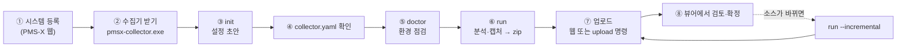

# As-Is 수집기 운영

> 레거시 시스템의 소스·DB 메타·화면을 분석하는 **pmsx-collector**(판 0.5.11)를 고객망 안 분석 PC에서 돌려 결과 패키지(zip)를 만들고, PMS-X에 올려 화면 분석 뷰어에 반영합니다. **대상**: 시스템 관리자·PM·PL·분석 담당(업로드), 현장 분석 PC 담당. **메뉴**: As-Is 분석 › 시스템 관리 · 수집 이력 / 업로드.



## 화면 구성

<figure><figcaption>As-Is 분석 › 수집 이력 / 업로드</figcaption></figure>

| 영역 | 하는 일 |
|---|---|
| **결과 패키지 업로드** | **시스템**, **결과 패키지 (.zip)**, **업로드** |
| **소스 분석기(수집기)** | **수집기 받기**(`pmsx-collector.exe · 크기 · 판`), **사용 순서**와 `collector.yaml`의 DB 부분 예시 |
| **수집 회차** | **회차 · 수집 일시 · 수집 통계**(화면 · 요소 · 요소 매칭률 · 처리 함수 연결률 · 소요 시간) **· 이전 회차 대비**(화면·요소·연결 +추가 −삭제), **변경 상세**, **리포트** |

## ① 시스템 등록

<figure><figcaption>As-Is 분석 › 시스템 관리 › 시스템 등록</figcaption></figure>

1. 상단에서 프로젝트를 고르고 **As-Is 분석 › 시스템 관리**를 엽니다.
2. **시스템 등록**을 누릅니다.
3. **시스템 코드**: 영문 대문자로 시작하는 2~20자(대문자·숫자·`_`), 예: `HR`. **수집기 설정의 `system.code`와 같아야** 업로드됩니다.
4. **시스템명**을 넣습니다. **화면 기술 · 서버 기술 · DB**는 비워 두면 첫 수집 패키지를 올릴 때 수집기가 감지한 값으로 채워집니다. **테스트계 URL**은 선택입니다.
5. **저장**을 누릅니다. 목록 행 끝의 👁는 **화면 분석 뷰어 열기**, ☁는 **수집 결과 업로드**입니다.

> **주의** 같은 프로젝트에 같은 시스템 코드는 두 번 등록할 수 없습니다("이미 등록된 시스템 코드입니다.").

## ② 수집기 설치

| 준비물 | 비고 |
|---|---|
| 분석 PC (Windows 10/11) | 디스크 여유 수 GB. Chrome 또는 Edge 설치(캡처·렌더링) |
| `pmsx-collector.exe` | **수집 이력 / 업로드 › 수집기 받기**로 받음(약 70MB). Python 불필요, 브라우저는 포함 안 됨 |
| 화면·서버 소스 | 읽기 권한. 수집기는 소스를 고치지 않음 |
| DB 읽기 전용 계정 또는 DDL 덤프 | 권장 — 테이블·관계·프로시저 품질이 크게 오름 |
| 메뉴 조회 SQL 또는 메뉴 CSV | 권장 — 없으면 화면 폴더 구조로 메뉴를 만듦 |
| 테스트계 URL·테스트 계정 | 선택 — 있으면 실제 화면 캡처와 버튼 클릭 관측. **운영계 금지** |

1. 망분리 환경이면 `pmsx-collector.exe` 한 파일만 반입합니다.
2. 작업 폴더를 소스 폴더 밖에 만듭니다(예: `D:\pmsx-work\HR\`).
3. `pmsx-collector.exe --help`로 실행되는지 확인합니다.

> **참고** "이 서버에는 수집기 파일이 없습니다."가 보이면 PMS-X 설치 폴더의 `collector\pmsx-collector.exe`를 확인합니다.

## ③ init — 설정 초안

```bat
pmsx-collector.exe init D:\src\hr-web --code HR --name 인사시스템
```

소스를 훑어 화면·서버 기술, 소스 폴더, DDL, 메뉴, DB 종류, 공통 호출 함수(`gfn_ajax` 등)를 추정해 `collector.yaml`을 만듭니다. 감지 근거는 파일 주석에 남습니다. 초안은 **캡처가 꺼진 상태**입니다.

## ④ collector.yaml 확인

꼭 볼 것:

```yaml
system:
  code: HR                  # ①에서 등록한 코드와 같게
  name: 인사시스템
source:
  root: D:/src/hr-web       # 읽기 전용으로만 사용
frontApis:                  # 프로젝트 공통 호출 함수 — init 추정값 확인
  gfn_ajax: { urlArg: 0 }
output: D:/pmsx-work/HR/out
```

| 설정 | 언제 |
|---|---|
| `db.ddlFiles` | DB 접속 없이 DDL 덤프로 테이블·컬럼·PK·FK·코멘트·프로시저 |
| `db.connection` | DB 읽기 전용 계정으로 직접 수집. 비밀번호는 `passwordEnv: PMSX_DB_PW`처럼 **환경 변수로만** |
| `menu.query` / `menu.csv` / `menu.router` / `menu.directory` | 메뉴 소스(하나 선택) |
| `capture.enabled: true` + `capture.baseUrl` · `login.steps` · `denyHosts` | 테스트계 실제 캡처 |
| `capture.mode: static-render` | 테스트계 없이 JSP를 HTML로 그려 캡처 |

지원 화면 기술: JSP/jQuery, Nexacro(N/14/17), XPlatform·MiPlatform, WebSquare, Vue/React, WinForms, ASP.NET WebForms/MVC. 서버: Spring(MyBatis/iBatis), Struts 1, .NET. DB: Oracle·Tibero·PostgreSQL·SQL Server·MySQL/MariaDB.

> **주의** 캡처 안전 규칙(끌 수 없음): 저장·삭제 같은 변경 요청(POST/PUT/PATCH/DELETE)은 `allowRequests`(조회성)가 아니면 기록 후 차단되어 서버에 닿지 않습니다. `dangerLabels`(삭제·저장·승인 등) 버튼은 누르지 않습니다. `denyHosts`(운영계)와 일치하면 실행을 거부합니다. 개인정보 영역은 `maskSelectors`로 가립니다.

## ⑤ doctor — 실행 전 점검

```bat
set PMSX_DB_PW=********
pmsx-collector.exe doctor -c collector.yaml
```

설정·소스 경로·출력 폴더 쓰기·디스크·한글 글꼴·브라우저 실행·대상 URL 응답·운영계 차단·DB 드라이버와 접속(읽기 전용 1건)을 봅니다. 하나라도 실패하면 종료 코드 1입니다. `--skip browser,network,db`로 해당 점검을 건너뜁니다.

## ⑥ run — 분석·캡처

```bat
pmsx-collector.exe run -c collector.yaml --no-capture    :: 1차: 정적 분석만(빠름)
pmsx-collector.exe run -c collector.yaml                 :: 캡처·렌더링 포함
pmsx-collector.exe run -c collector.yaml --incremental   :: 바뀐 화면만 다시
```

결과는 `out\pmsx-HR-<일시>.zip`(올릴 패키지: `model.json` + `captures\*.png` + `report.html`)과 실행 리포트입니다.

| 리포트에서 볼 것 | 목표(참고) |
|---|---|
| 요소 매칭률 | 90% 이상 |
| 버튼 → 핸들러 | 90% 이상 |
| 버튼 → API/서버 | 화면 안 동작 버튼 제외 90% 이상 |
| 버튼 → SQL·테이블 | 80% 이상 |
| 미연결 버튼과 원인 | 원인별로 설정 보완 |
| 차단된 요청 | 서버 도달 0건 |

> **참고** 연결률이 낮으면 대개 공통 함수 설정(`frontApis`, `struts.queryCalls` 등)이 빠진 것입니다.

## ⑦ 업로드

**A. 웹 (망분리 — zip을 반출한 뒤)**

1. **As-Is 분석 › 수집 이력 / 업로드**를 엽니다.
2. **대상 시스템**을 고르고 **결과 패키지 (.zip)**를 고릅니다.
3. **업로드**를 누릅니다. "업로드했습니다. 뷰어에 반영되었습니다."가 뜨고 **수집 회차**에 새 회차가 생깁니다.

**B. 명령 (망 연결)**

```bat
set PMSX_UPLOAD_PW=********
pmsx-collector.exe upload -c collector.yaml --server https://pmsx.example.local --user analyst
```

시스템 코드로 서버의 시스템을 찾아 최신 패키지를 올립니다. 비밀번호는 환경 변수로만 줍니다. 옵션: `--package x.zip --system HR`(파일 지정), `--project <ID|이름>`(같은 코드가 여러 프로젝트에 있을 때), `--ca-file`(사내 CA 인증서).

업로드 규칙:
- 같은 키(화면·요소·함수·SQL)는 갱신되고, **분석자가 수동 보정한 내용(핫스팟·연결·메모·확정)은 유지**됩니다.
- **변경 상세**에서 이전 회차 대비 추가·삭제된 화면·요소·연결을, **리포트**에서 그 회차의 실행 리포트를 봅니다.

<figure><figcaption>변경 상세 — 첫 회차는 모든 항목이 추가로 표시됩니다</figcaption></figure>

## ⑧ 뷰어에서 검토·확정

1. **분석 진척 현황**에서 화면을 골라 담당자를 일괄 배정합니다.
2. 담당자가 **화면 분석 뷰어**에서 미매칭 핫스팟·점선 연결을 보정하고 메모를 씁니다.
3. **ERD**에서 추정 관계를, **테이블 정의서**에서 주제영역·코멘트를 정리합니다.
4. 상태를 **검토요청** → PM·PL이 **확정**합니다.

자세한 사용법은 [As-Is 화면 분석](/user/pmsx/asis.md)과 [DB · PL/SQL 분석과 산출물](/user/pmsx/db.md)을 보세요.

## 문제 해결

| 증상 | 원인 | 조치 |
|---|---|---|
| "패키지의 시스템 코드가 선택한 시스템과 다릅니다." (`SYSTEM_MISMATCH`) | `system.code`와 서버 시스템 코드가 다름 | 둘 중 하나를 맞춤 |
| "수집기가 만든 .zip 패키지만 올릴 수 있습니다." / `PACKAGE_INVALID` | zip 손상, 수집기·서버 판 차이 | `pmsx-collector.exe validate out\...\model.json`으로 확인, 수집기 판을 서버에서 다시 받음 |
| 버튼은 많은데 API 연결이 거의 없음 | 공통 호출 함수 미등록 | `frontApis` · `frontNavigations` · `struts.queryCalls` 보완 |
| 한글이 깨짐 | 소스 인코딩 | UTF-8·EUC-KR은 자동 판별. 그 밖은 UTF-8로 바꾼 사본 분석 |
| 캡처가 로그인에서 멈춤 | 로그인 셀렉터·보안 프로그램 | `login.steps` 확인, 테스트계 보안 모듈 해제 요청 |
| 테이블 관계가 없음 | DB 메타·FK 없음 | DB 읽기 전용 계정 연결 또는 DDL 제공 |
| 테스트계 화면만 바뀜 | `--incremental`은 소스 변경만 감지 | 주기적으로 전체 수집 |
| ASP.NET 화면에 버튼이 빠지거나 버튼에 처리 연결이 없음 | 0.5.8 이하 수집기가 코드로 잇는 이벤트(`btnX.Click += …`)·그리드 명령 버튼·DevExpress/Telerik 컨트롤·사용자 컨트롤·VB.NET 코드비하인드·CP949 저장 소스를 읽지 못함 | 0.5.9 이상을 서버에서 다시 받아 다시 수집. 코드에서 만드는 버튼·변수로 조립하는 주소는 소스로 알 수 없으니 동적 캡처나 수동 연결로 보완 |
| Vue 2 + Spring 화면이 1개만 잡히고 API 가 404, 솔루션으로 나뉜 WebForms 에서 버튼·화면이 빠짐 | 0.5.9 이하 수집기가 `new Router`(해시 모드)·라우트 모듈 분리·라우터에 없는 화면, 하위 폴더 `web.config`·마스터 페이지를 읽지 못함 | 0.5.10 이상을 서버에서 다시 받아 다시 수집 |
| 수집이 도중에 멈추거나 파서 오류 하나로 전체가 실패, 다중 모듈 Java 의 서버 함수가 빠짐 | 0.5.10 이하 수집기가 UTF-8 이 아닌 파일에서 멈추고, `init` 초안이 모듈별 `src/main/java` 를 모두 넣지 않음 | 0.5.11 이상을 서버에서 다시 받아 `init` 부터 다시. 파서 오류는 리포트 '실패'에 남고 나머지는 계속 수집 |
| 화면 캡처·환경 점검 '브라우저'에서 `TargetClosedError` | 0.5.7 이하 수집기 + 확장 프로그램 정책이 걸린 PC 에서 Chrome·Edge 가 바로 종료 | 0.5.8 이상을 서버에서 다시 받음 |
| 앱 화면에 '백엔드와 연결이 끊겼습니다'(예전 판은 `Failed to fetch`) | 앱 백엔드가 내려감 | 창을 닫고 다시 실행. 내려간 사유는 `%APPDATA%\pmsx-collector\app.log` 에 남고, 비정상 종료였으면 다음 실행 때 화면 아래에 보임. '종료 기록 없이 끝남'이면 보안 프로그램이 프로세스를 끝냈을 수 있으니 예외 등록을 요청 |

## 보안 수칙

- 결과 패키지에는 소스 일부(함수·SQL 스니펫)가 들어갑니다. 고객사 반출 규정에 따라 다루고 외부 저장소·메일로 보내지 마세요.
- DB·테스트 계정·업로드 비밀번호는 환경 변수로만 줍니다. 설정 파일에 평문으로 적지 않습니다.
- 캡처는 테스트계에서만 합니다. 운영계 주소는 `denyHosts`에 넣습니다.

## 관련 쪽

- [As-Is 화면 분석](/user/pmsx/asis.md) · [DB · PL/SQL 분석과 산출물](/user/pmsx/db.md)
- [PMS-X 관리 개요](/admin/pmsx/README.md)
- [프로젝트와 멤버 — 협력사 열람 범위](/admin/pmsx/projects.md#협력사-열람-범위)
