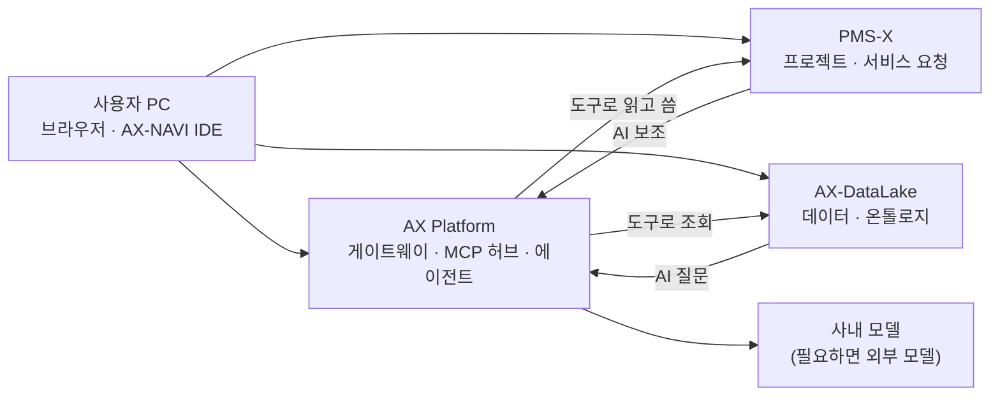

# 제품 구성과 역할별 길잡이

> 네 제품이 어떻게 이어져 있는지, 내 역할이면 어떤 화면부터 쓰면 되는지 한눈에 봅니다. **대상**: 모든 사람.

## 네 제품은 이렇게 이어져 있습니다

- **AX Platform** 이 가운데 있습니다. 채팅·에이전트·IDE 가 AI 모델을 부르면 플랫폼의 **LLM 게이트웨이**를 지나고, 업무 시스템(PMS-X·레이크 등)의 데이터를 쓰면 **MCP 허브**를 지납니다. 그래서 개인정보 가림·권한·승인·사용량 기록이 한곳에서 걸립니다.
- **PMS-X** 와 **AX-DataLake** 는 각자 화면이 있는 업무 시스템입니다. 안에서 쓰는 AI 기능은 플랫폼 게이트웨이를 거칩니다.
- **AX-NAVI IDE** 는 개발자 PC 에 설치합니다. 플랫폼에 로그인해 기기를 승인받으면 사내 모델과 허브 도구를 씁니다.

## 접속 주소

설치한 회사마다 다릅니다. 관리자에게 받으세요. 기본 포트는 아래와 같습니다.

| 제품 | 기본 주소 |
|---|---|
| AX Platform | `http://<서버>:8700` |
| PMS-X | `http://<서버>:8080` |
| AX-DataLake | `http://<서버>:8790` |
| 현업 창구 | `http://<서버>:8700/desk/<창구 이름>` (플랫폼 안의 별도 화면) |

계정은 제품마다 따로 있습니다. 관리자가 한 번에 만들어 주는 경우가 많으니 아이디와 처음 비밀번호를 관리자에게 받으세요. → [로그인과 화면 공통 사용법](/user/login.md)

## 역할별로 먼저 볼 화면

| 역할 | 주로 쓰는 제품 | 먼저 볼 쪽 |
|---|---|---|
| 개발자 | AX-NAVI IDE, AX Platform | [IDE 설치 · 로그인](/user/axnavi/install.md) → [채팅 · 모드 · 스킬](/user/axnavi/chat.md) → [변경 리뷰](/user/axnavi/review.md) |
| SM 운영자 | PMS-X, AX Platform | [서비스 요청 처리](/user/pmsx/sr.md) → [워크스페이스 채팅](/user/platform/chat.md) → [에이전트 실행](/user/platform/agents.md) |
| 분석가(As-Is·DB) | PMS-X | [As-Is 화면 분석](/user/pmsx/asis.md) → [DB · PL/SQL 분석](/user/pmsx/db.md) |
| PM · PL | PMS-X | [프로젝트 일정](/user/pmsx/project.md) → [인력 편성 · 작업 배분](/user/pmsx/resource.md) |
| 데이터 분석가 | AX-DataLake | [화면 구성과 데이터 찾기](/user/datalake/README.md) → [질의 · AI 질문](/user/datalake/query.md) |
| 현업 직원 | 현업 창구 | [현업 창구 — 현업 직원용](/user/platform/desk.md) |
| 승인 담당(팀장 등) | AX Platform | [대시보드와 승인함](/user/platform/dashboard.md) |
| 시스템 관리자 | 전부 | [관리자 매뉴얼 안내](/admin/README.md) |

## 장애 한 건이 지나는 길(예)

SM 현장에서 흔한 흐름입니다. 각 단계가 어느 화면인지 보여 줍니다.

| 단계 | 누가 | 어디서 |
|---|---|---|
| 1. 모니터링 경보가 들어옴 | 자동 | 플랫폼 에이전트의 **트리거**가 경보 진단 에이전트를 깨움 |
| 2. 원인 후보·확인 순서 정리 | 에이전트 | 지식 문서·매뉴얼을 근거로 — 실행 기록은 [에이전트](/user/platform/agents.md) |
| 3. 조치가 필요하면 승인 | 승인 담당 | [승인함](/user/platform/dashboard.md) |
| 4. 서비스 요청으로 접수·처리 | SM 운영자 | PMS-X [서비스 요청](/user/pmsx/sr.md) |
| 5. 코드 수정·리뷰 | 개발자 | AX-NAVI IDE [변경 리뷰](/user/axnavi/review.md) |
| 6. 처리 내용을 지식 문서로 | SM 운영자 | PMS-X 지식 문서 |
| 7. 사용량·효과 확인 | 관리자 | 플랫폼 [AI 사용 현황](/user/platform/usage.md) |
