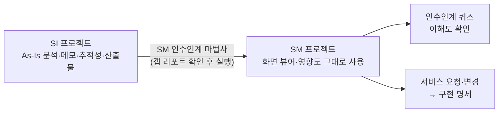

# 인수인계와 구현 명세

> SI(구축) 프로젝트가 끝날 때 화면 분석 자산을 SM(운영) 프로젝트로 넘기고, 넘기기 전 빈 곳을 점검하며, 인수자의 이해도를 퀴즈로 확인합니다. 운영 중에는 요청·변경 하나를 개발 도구에 넣을 **구현 명세**로 내려받습니다. **대상**: PM·시스템 관리자(인수인계 실행), PM·PL(퀴즈 관리), 운영 담당·개발자(퀴즈 응시·구현 명세). **메뉴**: 관리 › 프로젝트 관리 › **SM 인수인계** · 운영 › 인수인계 퀴즈 · 서비스 요청/변경·배포 › **구현 명세**.

## 인수인계 마법사

PM·시스템 관리자가 **관리 › 프로젝트 관리**에서 SI 프로젝트를 고르면 기간 옆에 **SM 인수인계** 버튼이 보입니다.

1. 왼쪽 **프로젝트** 목록에서 SI 프로젝트를 고르고 **SM 인수인계**를 누릅니다.
2. **1. 대상** — 인수인계 받을 곳을 고릅니다.
   - **새 SM 프로젝트 만들기**: 프로젝트명(기본 "○○ 운영(SM)")·고객사·PM·시작일·종료일을 넣습니다.
   - **기존 SM 프로젝트**: 목록에서 고릅니다.
3. **다음** → **2. 범위**에서 고릅니다.

<figure><figcaption>2. 범위 — 옮길 시스템·인력·항목</figcaption></figure>

| 항목 | 옮겨지는 것 |
|---|---|
| **시스템** | 화면·요소·연결·캡처·테이블·분석 상태·메모. `화면 n (확정 n)`으로 확정 수가 보입니다. SI 쪽 이력은 그대로 남습니다 |
| **함께 옮길 인력** | 고른 사람을 SM 프로젝트 인원으로 추가 |
| **함께 옮길 항목** | **업무 규칙 메모** · **추적성 링크** · **산출물** · **미해결 결함을 서비스 요청(접수)으로 만들기** |

4. **다음** → **3. 미리보기**에서 복사될 양과 갭 리포트를 확인합니다.

<figure><figcaption>3. 미리보기 — 복사될 양과 인수인계 갭 리포트</figcaption></figure>

5. 문제가 없으면 **인수인계 실행**을 누릅니다. **4. 결과**에 복사된 항목 수가 나오고, **SM 프로젝트로 이동**으로 넘어갑니다.

> **주의** 실행하면 되돌릴 수 없습니다. 미리보기의 갭 리포트에서 준비도가 낮으면 먼저 보완하세요. 실행 전에는 **이전**으로 돌아가거나 **취소**할 수 있습니다.

> **참고** 인수인계로 만든 SM 프로젝트는 프로젝트 관리 화면에 **SI 에서 인수인계됨** 표시가 붙습니다.

## 인수인계 갭 리포트 읽기

마법사 미리보기 아래에 나오는 점검 결과입니다. 규칙 기반이며 AI를 쓰지 않아 매번 같은 결과가 나옵니다.

| 항목 | 보는 것 |
|---|---|
| 분석 완료율 | 확정(DONE)된 화면 비율 |
| 요소 매칭률 | 미매칭 요소 수 |
| 연결 확정률 | 신뢰도가 낮은 채 확정되지 않은 연결 |
| 업무 메모 보유율 | 메모가 있는 화면 비율 |
| 산출물 확정률 | 승인된 산출물 비율 |
| 담당 배정률 | 담당자가 없는 화면 |
| 미해결 결함 | 열린 결함 수 |

- 항목마다 **가중**과 **점수**, 합계 **준비도**와 판정(예: 인수 위험)이 나옵니다.
- **인수자 질문**은 빈 곳마다 만들어진 구체적 질문입니다(예: 미해결 결함의 원인·처리 계획). 일부만 보이고 나머지는 파일에 있습니다.
- **리포트 내려받기(MD)**로 받아 인수인계 회의 자료로 씁니다.

## 인수인계 퀴즈

<figure><figcaption>퀴즈 결과 — 정답률이 낮은 분야가 보충 인수인계 대상</figcaption></figure>

As-Is 분석(화면·버튼·테이블)·요청 이력·업무 절차·처리 기한에서 자동으로 문제를 냅니다. 분야는 **화면·데이터 · 요청 이력 · 업무 절차 · 처리 기한**입니다.

**퀴즈 만들기** (시스템 관리자·PM·PL)

1. SM 프로젝트에서 **운영 › 인수인계 퀴즈**를 엽니다.
2. **퀴즈 만들기**를 누릅니다.
3. **제목**(비우면 "인수인계 이해도 확인"), **대상 시스템 (비우면 전체)**, **문제 수**(3~30)를 넣고 저장합니다.

**응시하기** (누구나)

1. 퀴즈 카드의 **응시**를 누릅니다.
2. 모든 문제에 답하고 **제출**을 누릅니다. 답하지 않은 문제가 있으면 제출되지 않습니다.
3. 점수, 문제별 **정답/오답**과 해설, **분야별** 결과가 나옵니다.

**결과 보기** (시스템 관리자·PM·PL): 카드의 **결과** → 분야별 정답률, **응시자**별 **첫 응시 · 최고 · 최근** 점수와 응시 횟수, 문제별 **정답률**. 카드에는 첫 응시 평균과 전체 평균 점수가 보입니다.

> **참고** 업무 절차 문제는 [업무 템플릿](/user/pmsx/sr.md#운영의-다른-메뉴)의 절차 순서에서, 처리 기한 문제는 처리 기한 정책에서 나옵니다. 템플릿과 정책을 먼저 정리하면 퀴즈가 실제 업무에 맞습니다.

## 구현 명세 내보내기

<figure><figcaption>구현 명세 — 요청 하나를 개발 도구 입력용 파일로</figcaption></figure>

요구사항·버튼 흐름·영향 테이블·소스 위치·테스트 케이스를 한 파일로 묶습니다. AX-NAVI 같은 코딩 에이전트에 넣으면 어디를 고칠지부터 시작합니다.

1. **운영 › 서비스 요청**에서 요청을 엽니다(또는 **변경·배포**에서 변경 건).
2. 상세 머리의 **구현 명세**를 누릅니다.
3. **Markdown 내려받기** 또는 **JSON 내려받기**를 고릅니다.

| 담기는 것 | 출처 |
|---|---|
| 요구사항 | 요청·변경 본문과 처리 코멘트 |
| 대상 버튼 워크플로우 | As-Is 분석 그래프 |
| 영향 테이블·컬럼 | 영향도 분석 |
| 소스 위치와 스니펫 | 수집 결과 |
| 테스트 케이스 | 흐름과 CRUD에서 도출 |

> **주의** 소스 스니펫이 들어가므로 **내부 역할**(시스템 관리자·PMO·PM·PL·운영 담당·분석 담당·개발자·품질 담당)만 버튼이 보입니다. 고객·협력사는 쓸 수 없습니다. 파일은 회사 반출 규정에 따라 다루세요.

> **참고** 대상 화면이 정해진 요청일수록 명세가 정확합니다. 요청 등록 때 **대상 화면**과 버튼까지 골라 두세요.

## 관련 쪽

- [프로젝트와 멤버](/admin/pmsx/projects.md) — 프로젝트 관리 화면
- [서비스 요청 처리와 지식 문서](/user/pmsx/sr.md)
- [As-Is 화면 분석](/user/pmsx/asis.md) · [영향도 분석](/user/pmsx/db.md#영향도-분석)
- [채팅 · 모드 · 스킬 (AX-NAVI IDE)](/user/axnavi/chat.md)
